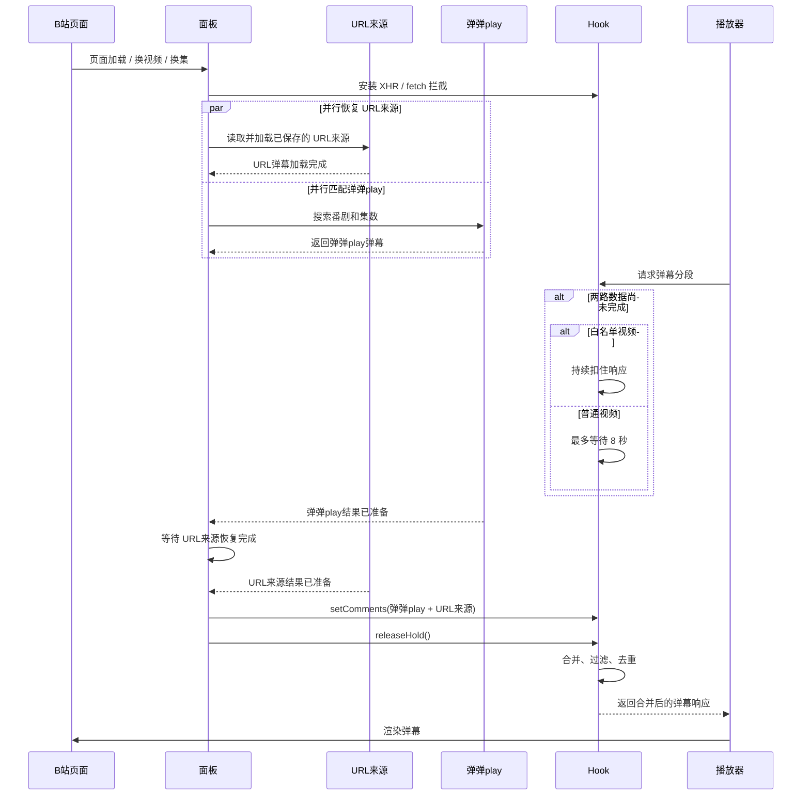

# Danmaku Enhance

> 基于 [agefans enhance](https://github.com/IronKinoko/agefans-enhance) 的 fork。
> 保留上游「替换站点播放器」的能力，并额外实现一项功能：**将第三方弹幕注入哔哩哔哩原生播放器**。

弹幕存于弹弹play，播放器习惯用哔哩哔哩。本项目将两者结合：不替换播放器、不安装额外插件、
不修改哔哩哔哩的任何设置，开启开关后，当前视频的弹幕流中即包含第三方弹幕。

## 哔哩哔哩：实现方式

URL 弹幕源恢复与弹弹play匹配并行进行，播放器放行前等待两路数据汇合：



哔哩哔哩播放器按 6 分钟一段请求弹幕：

```
GET api.bilibili.com/x/v2/dm/web/seg.so?type=1&oid=<cid>&segment_index=<n>
→ protobuf（DmSegMobileReply，内含 DanmakuElem 列表）
```

脚本在页面内接管该请求：自行获取弹幕、与第三方源合并，再将合并后的响应交还播放器。
播放器收到的仍是其可解析的 protobuf，因此：

- 播放器未被替换，快捷键、清晰度切换、倍速、网页全屏均为原生实现
- 弹幕渲染、字号、透明度、速度与屏蔽词仍由哔哩哔哩自身设置决定
- 注入弹幕与原生弹幕处于同一图层、同一轨道，不存在两套弹幕速度不一致的问题

配套功能包括：按标题自动匹配番剧、多路 URL 弹幕源、对全部弹幕生效的过滤器、可调时间偏移。


> 真实运行截图。左侧为哔哩哔哩原生播放器（弹幕、控制条、清晰度、倍速均为原生实现），
> 右侧面板由脚本挂载，左下角为注入结果提示。面板自上而下依次为：匹配到的番剧与集数、
> 弹弹play匹配、URL 弹幕源、强制匹配 UP 主名单、过滤器；后三块默认收起，点击标题右侧箭头展开。

## 功能

### 哔哩哔哩

- **弹幕混流**：将弹弹play的弹幕并入哔哩哔哩原生弹幕流，播放器不作改动
- **多源并存**：弹弹play、哔哩哔哩链接、巴哈姆特动画疯链接可同时挂载，URL 源最多 3 条
- **标题自动匹配**：对标题逐级清洗，依次尝试多组关键词，并以最长公共子串剔除无关结果；
  季度与集数均有对应规则。置信度不足时列出候选交由用户确认，亦支持手动检索
- **过滤器作用于全部弹幕**：屏蔽词、按位置屏蔽（滚动／顶部／底部）、相似弹幕合并、每分钟密度上限，
  对原生弹幕与注入弹幕同时生效
- **时间轴偏移**：每个 URL 源可单独设置偏移量，支持正负小数，修改即时保存
- **UP 主白名单**：将常看的 UP 主加入名单后，其视频完成匹配再开始播放，
  避免因延后选集而丢失首段弹幕；主动点击播放即立即放行，不中断观看
- **面板内嵌于控制条**：控制条右侧提供入口图标，点击展开；点击面板外部或再次点击图标即收起
- **按 cid 记忆**：匹配结果、URL 源与偏移量按视频保存，下次打开保持一致

### 其它站点

替换站点自带播放器，提供完整播放能力：

- 弹幕
- 画中画
- 自动换集、无缝换集
- 快捷键体系，支持自定义
- 调整播放器外边框，适配视频比例
- 记录播放位置，自动续播
- 按 <kbd>?</kbd> 键调出脚本信息窗口，查看**视频信息**与**快捷键**
- 多站点适配，可搜索相同视频资源与种子

## 支持的网站

| 站点 | 处理方式 |
| --- | --- |
| [哔哩哔哩](https://www.bilibili.com) | 不替换播放器，将第三方弹幕合并进原生弹幕流 |
| [agefans](http://www.age.tv) | 替换播放器 |
| [bimiacg](http://www.bimiacg14.net) | 替换播放器 |
| [次元城](https://www.cycani.org) | 替换播放器 |
| [稀饭动漫](https://next.xifanacg.com) | 替换播放器 |
| [Anime1](https://anime1.me) | 替换播放器 |
| [咕咕番](https://www.gugu3.com) | 替换播放器 |
| [girigiri 爱](https://anime.girigirilove.com/) | 替换播放器 |
| [吐槽弹幕网](https://www.tucao.my/) | 替换播放器 |
| [独立播放器](https://ironkinoko.github.io/agefans-enhance/) | 替换播放器 |

哔哩哔哩侧仅处理视频页与番剧／影视播放页，**直播页直接跳过**（直播不提供分段弹幕接口）。

## 安装

1. 安装 [Tampermonkey](https://www.tampermonkey.net/)（Violentmonkey 亦可）
2. 安装脚本：[index.user.js](https://github.com/IYIAK/danmaku-enhance/raw/gh-pages/index.user.js)

推送 `master` 后由 GitHub Actions 自动构建并发布至 `gh-pages` 分支，上述地址始终为最新构建。

## 哔哩哔哩使用方法

0. 打开任意视频，点击控制条右侧的弹幕图标，开启面板中的「启用注入」开关
1. 面板按当前标题自动匹配番剧；结果不准确时可手动检索，或直接将视频链接填入 URL 弹幕源
2. 时间轴不一致时填写偏移量；弹幕过密时使用过滤器
3. 如需确认版本：面板标题旁常驻显示当前运行的版本号

> **若已播放一段时间后才开启开关，当前分段可能没有注入弹幕。**
> 哔哩哔哩播放器会将已请求的分段缓存在内存中，脚本无法令其重新请求。面板会提示「本段已缓存」，
> 点击旁边的刷新图标（或刷新页面）后重新开启开关即可。

## 常见问题

**匹配结果不正确或检索不到？**
弹弹play采用纯子串检索，单次最多返回 25 条并按编号排序 —— **结果为 0 条并不代表库中不存在该作品**。
可在面板的手动搜索框中输入更长、更接近原名的片段；或在哔哩哔哩找到对应视频，将链接填入 URL 弹幕源。

**是否会和哔哩哔哩原生弹幕重复？**
默认启用「与原生去重」：比对时忽略空白、标点、全角半角与大小写，与原生弹幕时间差 ±1.5 秒、
注入弹幕之间 ±1.8 秒均视为重复。如需两侧同时显示，可关闭该选项。

**是否支持直播？**
不支持。直播页不提供分段弹幕接口，脚本会直接跳过。

**是否会影响 agefans 原有站点的功能？**
不影响。哔哩哔哩走独立适配层，仅接管弹幕分段请求与面板，原有播放器替换逻辑未作改动。

## 权限声明

| 权限 | 用途 |
| --- | --- |
| `GM_xmlhttpRequest` | 请求弹幕接口。仅访问 **dandanplay.net**、**api.bilibili.com**、**ani.gamer.com.tw** |
| `GM_getValue` / `GM_setValue` | 保存播放器配置、匹配结果、URL 弹幕源与偏移量 |
| `GM_info` | 在面板中显示当前运行的脚本版本 |
| `GM_registerMenuCommand` | 注册脚本菜单项 |
| `@include` | 匹配上述列出的站点 |

跨域白名单固定写在 `meta.template` 的 `@connect` 中，亦可在 Tampermonkey 的
「设置 → XHR 安全」中逐条管理。全部数据仅存于本地，不上传至任何服务器。

## 版本号规则

本项目自 fork 起点（上游基线 1.60.3）重新计数：

- `2.0.0` = 「哔哩哔哩弹幕注入」达到日常可用状态
- 此后**修复与收尾递增修订号**（`2.0.11`、`2.0.12`）
- **新功能递增次版本号**（`2.1.0`、`2.2.0`）

早期 `1.60.4`～`1.60.9` 为沿用上游主次号的临时编号，已按新规则对应。

## 开发

```bash
pnpm install
pnpm dev      # 监听构建（bocchi）
pnpm build    # 产出 dist/index.user.js
pnpm lint     # tsc --noEmit
```

源码结构：

```
src/
├── index.ts              # 入口：样式 + 适配层 + runtime.run()
├── runtime/              # 站点注册、SPA 路由、单例运行时
├── player/               # KPlayer（基于 Plyr）与插件：弹幕、快捷键、自动换集
├── adapter/
│   ├── <站点>/           # 各站点适配器
│   └── bilibili/         # 哔哩哔哩注入：见下
└── utils/                # 存储、请求、UI 小工具
```

`src/adapter/bilibili/` 各文件职责：

| 文件 | 职责 |
| --- | --- |
| `hook.ts` | 接管 XHR/fetch，将第三方弹幕合并进分段响应 |
| `proto.ts` | 最小 protobuf 编解码（仅处理所需字段，其余原样搬运） |
| `match.ts` | 标题清洗、候选关键词、番剧与集数匹配 |
| `info.ts` | 从页面状态读取当前视频的标题、cid 与集数 |
| `panel.ts` | 控制条按钮与弹出面板 |
| `sources/` | URL 弹幕源：哔哩哔哩、巴哈姆特动画疯 |
| `filters.ts` | 弹幕过滤器（对原生与注入弹幕同时生效） |
| `store.ts` | 配置与 URL 源的持久化 |

官网位于 `site/`（一页介绍 + 一页更新日志），纯静态、零外部依赖，构建方式见 `site/README.md`。

## 致谢与许可

- 上游项目：[IronKinoko/agefans-enhance](https://github.com/IronKinoko/agefans-enhance)
- 弹幕服务：[弹弹play](https://www.dandanplay.com/)
- 弹幕渲染库：[@ironkinoko/danmaku](https://github.com/IronKinoko/danmaku)

MIT License，见 [LICENSE](./LICENSE)。
